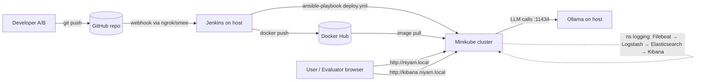
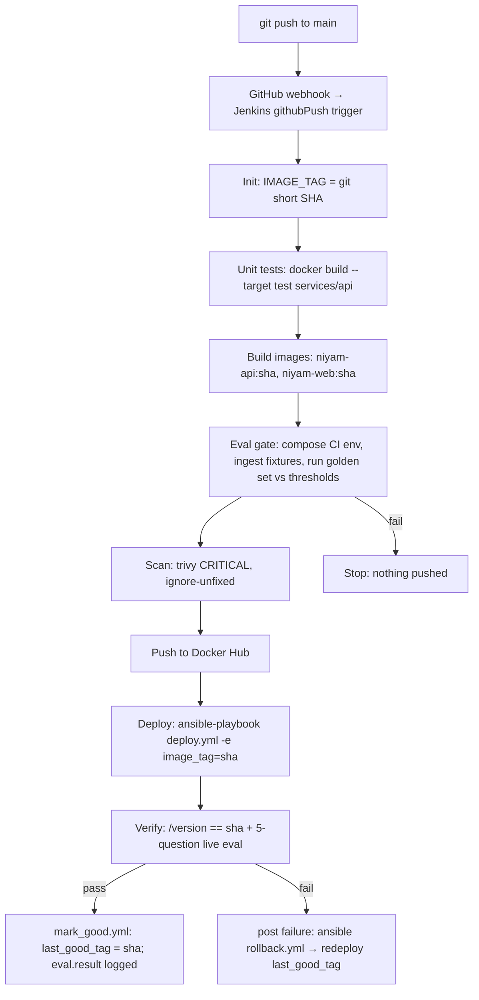

# ARCHITECTURE — Niyam

> Spec: `context/SPEC.md` (wins on conflict). Requirements: `context/PRD.md`. One-page viva version: `context/ARCHITECTURE_ESSENTIAL.md`.

## 1. Architectural principles

1. **Spec tools first.** Use exactly the spec's toolchain (Git/GitHub, Jenkins, Docker + Compose, Ansible, Kubernetes, ELK) plus the "encouraged" extras (Vault, Ansible roles, HPA, live patching). Anything else needs a written reason (§12).
2. **One laptop.** Everything runs on one 16 GB machine. Jenkins and the LLM run on the **host**; the **application and its ELK logging stack** run in **Kubernetes** (§3 explains the split).
3. **One deploy path.** Humans and Jenkins both deploy only through `ansible-playbook deploy.yml -e image_tag=<sha>`.
4. **Immutable, traceable releases.** Image tag = git short SHA. That SHA appears in the image, the pod labels, every log line, the UI footer and the eval results.
5. **Fail before users see it.** Tests → eval gate → scan → push → deploy → verify → auto-rollback.
6. **App kept small.** Two images we build (`api`, `web`), one vector DB, one external LLM endpoint.

## 2. System context



## 3. Deployment topology (where each thing runs)

```
┌─────────────────────── Laptop (Windows 11 + Ubuntu WSL2, 16 GB) ────────────────────────┐
│  WINDOWS: Jenkins controller (service, :8080)                                           │
│  UBUNTU WSL2 (systemd)                                                                  │
│   • Jenkins agent (niyam-wsl) ── runs docker, trivy, ansible, kubectl                   │
│   • Ollama (native, 127.0.0.1:11434)  model: qwen2.5:3b                                 │
│   • smee/ngrok relay  → exposes Jenkins /github-webhook/                                │
│   • Docker Compose only for local dev + the CI eval-gate environment                    │
│                                                                                         │
│  MINIKUBE (docker driver, 4 CPU, memory cap 9 GB, disk 40 GB; addons ingress, metrics)  │
│   ns: niyam                                                                             │
│    • Deployment niyam-api  (2–4 pods, HPA)  FastAPI + in-process embedder + Vault agent  │
│    • Deployment niyam-web  (2 pods)         nginx serving static UI                      │
│    • StatefulSet qdrant    (1 pod, PVC 2Gi) vector DB, API-key protected                 │
│    • Job niyam-ingest-<sha8>                parse → chunk → embed → upsert               │
│    • Service ollama (selector-less + EndpointSlice → host IP:11434)                      │
│    • Ingress: niyam.local  /api, /version, /readyz → api,  / → web                       │
│   ns: logging                                                                           │
│    • DaemonSet filebeat          → logstash.logging.svc:5044                             │
│    • Deployment logstash (1)     → elasticsearch.logging.svc:9200                        │
│    • StatefulSet elasticsearch (1, PVC 5Gi, single-node, heap 1g)                        │
│    • Deployment kibana (1)       Ingress kibana.niyam.local                              │
│   ns: vault    • Vault (dev mode, Helm chart) + Agent Injector                           │
└─────────────────────────────────────────────────────────────────────────────────────────┘
```

**What runs where, and why.**
- **In Kubernetes: the app *and* ELK.** ELK has no hardware dependency and is the app's own observability
  stack, so it lives next to the app. That gives one platform, one deploy tool (Ansible roles), in-cluster
  DNS for Filebeat → Logstash, and the same Vault injector for ELK passwords. It also shows more Kubernetes
  work (StatefulSet + PVC, DaemonSet + RBAC, Ingress) for the "Orchestration" part of the spec.
- **On the host: Jenkins.** Jenkins *creates and deploys to* the cluster. If it lived inside the cluster, a
  `minikube delete` would also delete the tool that rebuilds it. CI servers usually sit outside the cluster they deploy to.
- **On the host: Ollama.** A 1–2 GB model inside the minikube node is slower (no GPU/Metal) and makes every
  cluster rebuild re-download it. The app treats it like an external model API, reached through a K8s Service.

Say this split in one sentence in the report and the viva: *"The app and its observability run in Kubernetes;
the CI server and the model server are external dependencies, as they would be in production."*

### 3.1 Demo platform: Windows 11 + Ubuntu 24.04 on WSL2

"Host" in this document means the **Ubuntu WSL2 distribution**, except for the Jenkins controller, which is a Windows service. Docker Desktop provides the Docker engine through WSL integration.

| Concern | Setting |
|---|---|
| Jenkins | The Windows controller schedules builds on Ubuntu agent `niyam-wsl`, which runs as the developer account and connects over WebSocket (`make agent-install`) |
| GitHub webhook | GitHub → ngrok tunnel run by an Ubuntu service (`make relay-install`) → Jenkins `/github-webhook/`. A traffic policy blocks every other path, so the rest of Jenkins stays private |
| WSL limits | `%USERPROFILE%\.wslconfig`: `memory=12GB`, `swap=8GB`, `processors=8` |
| Cluster | `minikube start -p niyam --driver=docker --kubernetes-version=v1.32.2 --cpus=4 --memory=9g --disk-size=40g --embed-certs --ports=127.0.0.1:80:80` |
| Browser access | Windows hosts file: `127.0.0.1 niyam.local kibana.niyam.local`. The ingress controller is published on `127.0.0.1:80` |
| Access from Ubuntu | WSL does not copy that hosts entry, so scripts use `curl --resolve niyam.local:80:127.0.0.1` |
| After a WSL restart | The API server's host port changes, and the first `minikube start` can fail while the cluster is healthy. `make cluster-up` retries once and updates the kubeconfig the agent uses |

## 4. Components

| Component | Tech | Responsibility | Built by us? |
|---|---|---|---|
| `niyam-api` | Python 3.12, FastAPI, uvicorn, `fastembed` (BAAI/bge-small-en-v1.5, 384-d), `qdrant-client`, `httpx` | `/ask`, `/search`, `/feedback`, `/documents`, `/healthz`, `/readyz`, `/version`; RAG pipeline; JSON logs | Yes |
| `niyam-ingest` | Same image as api, command `python -m app.ingest.cli` | Read manifest → parse PDFs (pypdf) → chunk → embed → idempotent upsert | Yes |
| `niyam-web` | nginx-unprivileged + vanilla HTML/JS | Question box, answer, citation cards, feedback buttons, version footer | Yes |
| Qdrant | qdrant/qdrant (pinned) | Vector storage + payload filters | No |
| Ollama | Host install | LLM text generation (`/api/chat`) | No |
| Vault | hashicorp/vault Helm chart | KV v2 secrets, K8s auth, Agent Injector | No |
| Filebeat | elastic/filebeat 8.x DaemonSet (ns `logging`) | Tail container logs from `ns=niyam` → Logstash | No |
| Logstash | 8.x Deployment (ns `logging`) | Parse JSON, enrich, route to ES | No |
| Elasticsearch | 8.x StatefulSet, single node, PVC (ns `logging`) | Store + index logs | No |
| Kibana | 8.x Deployment + Ingress `kibana.niyam.local` (ns `logging`) | Dashboards | No |
| Jenkins | Native LTS | Pipeline orchestration | No |

## 5. Request flow — `/api/v1/ask`

```mermaid
sequenceDiagram
  participant B as Browser
  participant I as Ingress (nginx)
  participant A as niyam-api pod
  participant Q as Qdrant
  participant O as Ollama (host)
  B->>I: POST /api/v1/ask {question}
  I->>A: proxy (read timeout 120s)
  A->>A: request_id, validate, embed query (in-process, CPU)
  A->>Q: search top_k=6 (+filters), api-key from /vault/secrets/qdrant
  Q-->>A: chunks + scores
  alt top_score < REFUSAL_THRESHOLD (0.68)
    A-->>B: refused=true, fixed message (no LLM call)
  else
    A->>A: build prompt from prompts/v{N}.txt + numbered context
    A->>O: /api/chat (num_predict 256, temperature 0.1, timeout 60s)
    O-->>A: answer text
    A->>A: verify cited [n] exist; NOT_FOUND or no valid citation becomes a refusal
    A-->>B: answer, citations, latency_ms, app_version, prompt_version
  end
  A-->>A: log request.completed (stdout JSON)
```

`/search` is the same flow up to Qdrant, without generation. It is **CPU-bound inside the pod** (embedding), which is what makes HPA meaningful (§9).

## 6. CI/CD flow (Jenkins)



Notes
- **Tests run inside Docker** (`test` stage of the multi-stage Dockerfile), so the Jenkins host needs no Python toolchain.
- **Eval gate environment** (`docker-compose.ci.yml`): the freshly built `niyam-api:<sha>` + an ephemeral Qdrant + host Ollama. Fixture corpus of 3 docs. All golden questions run in retrieval mode; an 8-question subset runs with generation (CPU LLM time budget about 3 min).
- **Ingest on every release:** `deploy.yml` runs the `ingest` Job, which skips unchanged documents and restores the index if Qdrant lost its data. `-e force_ingest=true` replaces an existing Job for the same release. Job name `niyam-ingest-<sha8>` makes each release's run unique.
- **Concurrency:** `disableConcurrentBuilds()`. Two pushes in quick succession queue; they never deploy in parallel.

## 7. Logging flow (ELK)

```
api/web/ingest stdout (1 JSON line per event)
  → /var/log/containers/*.log on minikube node
  → Filebeat DaemonSet (autodiscover, only ns=niyam, adds kubernetes.* metadata)
  → Logstash Service logstash.logging.svc:5044 (in-cluster DNS; no host networking involved)
       filter: json{source=>message, target=>app}; date{match=>[app.ts]}; drop health-check noise
  → Elasticsearch index  niyam-app-YYYY.MM.dd  (index template: infra/elasticsearch/index-template.json)
  → Kibana data view  niyam-app-*  → dashboard "Niyam — App & Releases" (infra/kibana/dashboards.ndjson)
```

**Dashboard panels (minimum 8):** requests/min by endpoint; p50/p95 latency (`app.latency_ms.total`); error rate (status ≥ 500); refusal rate; top 10 questions; **`app_version` share over time** (shows the rolling update); LLM generation time vs retrieval time; feedback up/down; **eval results per release** (`event: eval.result`); pod count by `kubernetes.pod.name` (shows HPA scale-out).

Web (nginx) access logs are also JSON (custom `log_format`) and flow the same way.

## 8. Secrets flow (Vault)

```
ansible-vault encrypted group_vars/all/vault.yml   (bootstrap values: ES passwords, qdrant key seed)
   │  role vault (Ansible): helm install vault (dev mode) → enable kv-v2 at secret/
   │                        → put secret/niyam/qdrant {api_key}, secret/niyam/elastic {...}
   │                        → enable auth/kubernetes; policies niyam-api, niyam-qdrant (read-only paths)
   │                        → roles bound to SA niyam-api / qdrant in ns niyam
   ▼
Pod annotations (vault.hashicorp.com/agent-inject*) → Vault Agent init+sidecar → /vault/secrets/qdrant
   api: reads QDRANT_API_KEY_FILE      qdrant: wrapper `export QDRANT__SERVICE__API_KEY=$(cat …); exec ./entrypoint.sh`
ELK (ns logging): same injector pattern. ES gets /vault/secrets/elastic (ELASTIC_PASSWORD_FILE), Logstash and Kibana get
     their own passwords via a tiny wrapper that exports the file into an env var, then exec's the normal entrypoint.
     The Ansible elk role reads the same paths (community.hashi_vault) only to create users and import dashboards.
Jenkins: Docker Hub creds + ansible-vault password stored as Jenkins Credentials (never in Jenkinsfile)
```

**Vault runs in dev mode** (in-memory). The `vault` role re-seeds idempotently on every `site.yml`/`deploy.yml`, so a restarted Vault pod self-heals on the next run. Production would use Raft storage + auto-unseal. Say this in the viva; don't pretend dev mode is production.

## 9. Scaling, availability and live patching

| Setting | Value | Why |
|---|---|---|
| `niyam-api` requests / limits | cpu 250m / 1, mem 512Mi / 1Gi | HPA needs requests; embedder needs ~300 MB |
| HPA | min 2, max 4, CPU 60%, scaleDown stabilization 60s | Visible scale-out within ~1 min under `/search` load |
| Deployment `replicas` | **omitted** from the template once the HPA exists | Otherwise every Ansible deploy resets the replica count and fights the HPA |
| Strategy | RollingUpdate `maxSurge: 1, maxUnavailable: 0` | Old pod stays until the new one is Ready |
| Readiness `/readyz` | embedder loaded + Qdrant reachable. **Not** Ollama | An Ollama hiccup must not make every pod unready (full outage) |
| Liveness `/healthz` | process up only | Avoid restart loops on slow dependencies |
| `preStop` | `sleep 5` | Lets the ingress endpoints update before SIGTERM |
| `terminationGracePeriodSeconds` | 30 | uvicorn finishes in-flight requests |
| Ingress | `proxy-read-timeout: 120` | Default 60s would 504 slow CPU generations |
| web `index.html` | `Cache-Control: no-cache`; JS/CSS `?v=<sha>` | "Refresh shows the change" works without hard reload |

**Why HPA scales on `/search`, not `/ask`:** `/ask` mostly waits on Ollama (I/O), so pod CPU stays low and the
bottleneck is the single host LLM. Scaling pods can't fix that. Embedding is in-process, so `/search` load is real CPU on the pods.
Say this in the viva; it shows you understand what HPA can and can't fix.

## 10. Networking and ports

| From | To | Port | How addressed |
|---|---|---|---|
| Browser | Ingress | 80 | `niyam.local` → `127.0.0.1` in the Windows hosts file (§3.1) |
| Ingress | niyam-api / niyam-web | 8000 / 8080 | ClusterIP Services. Prefix `/api` and exact `/version`, `/readyz` → api; `/` → web |
| api / ingest | Qdrant | 6333 (HTTP) | `qdrant.niyam.svc:6333` |
| api | Ollama | 11434 | Service `ollama` + EndpointSlice → Docker Desktop's `host.docker.internal` address (found by the Ansible `ollama` role) |
| Filebeat | Logstash | 5044 | `logstash.logging.svc` |
| Logstash / Kibana | Elasticsearch | 9200 | `elasticsearch.logging.svc` |
| Browser | Kibana | 80 → 5601 | Ingress `kibana.niyam.local` |
| GitHub | Jenkins | 8080 via ngrok/smee | `https://<relay>/github-webhook/` |
| Jenkins | Docker Hub / minikube API | 443 / 8443 | Credentials / embedded-cert kubeconfig |

## 11. Resource budget (16 GB laptop)

With the **docker driver**, minikube's memory setting is a *cap*, not a reservation. The node only uses
what its pods use. (VirtualBox/KVM drivers pre-allocate the full amount, so don't use them.)

| Item | Requests / limit | Typical RAM |
|---|---|---|
| K8s system (control plane, ingress, metrics-server, CoreDNS) | — | ~1.0 GB |
| niyam-api ×2 (up to 4 under HPA) | 512Mi / 1Gi each | 1.2–2.4 GB |
| niyam-web ×2, qdrant, vault + injector, filebeat | small | ~0.8 GB |
| Elasticsearch (heap 1g) | 1.5Gi / 2Gi | ~1.6 GB |
| Logstash (heap 512m) | 768Mi / 1.2Gi | ~0.9 GB |
| Kibana | 768Mi / 1.2Gi | ~0.8 GB |
| **Minikube subtotal** | cap 9 GB | **≈ 6.3–7.5 GB** |
| Jenkins (host) | | ~0.8 GB |
| Ollama + qwen2.5:3b (host) | | ~2.1 GB |
| OS + browser + IDE | | ~3 GB |
| **Total** | | **≈ 12.5–13.5 GB**: fits, with limited headroom. Close the IDE during the demo. |

Lite mode (≤12 GB laptop): `ollama_model: qwen2.5:0.5b-instruct`, ES heap 768m, Logstash heap 384m, HPA max 3.
Emergency fallback (not maintained unless needed): run the same three Elastic images on the host with Docker
Compose and point Filebeat at the host IP (about 1 hour of work).

## 12. Key decisions (ADR summary)

| # | Decision | Alternatives rejected | Reason |
|---|---|---|---|
| 1 | Jenkins **native** on host | Jenkins in Docker | Docker-in-Docker + minikube kubeconfig + socket permissions are the #1 time sink |
| 2 | ELK **in Kubernetes** (ns `logging`) as plain manifests templated by the Ansible `elk` role | ELK on host via Compose; ECK operator; Elastic Helm charts | One platform for the app and its logs; Filebeat → Logstash over cluster DNS (no fragile host IP); ELK passwords come from the same Vault injector as the app; no extra operator/CRDs to explain. ECK also keeps its own passwords in K8s Secrets, which cuts across the Vault story. Elastic deprecated its Helm charts in favour of ECK |
| 3 | K8s manifests as **Jinja2 templates in Ansible roles** | Helm chart for our app, Kustomize | Spec names Ansible; one fewer tool; image tag injection is trivial |
| 4 | Vault Helm chart (dev mode) + Agent Injector | K8s Secrets, Sealed Secrets, ansible-vault only | Spec names Vault; the injector shows secrets never touch etcd |
| 5 | Embeddings in-process (`fastembed`), generation on Ollama | Everything on Ollama | Makes HPA real; faster search; fewer network hops |
| 6 | Ollama on host | Ollama Deployment in K8s | 2 GB model pulls into minikube, slow CPU-only VM |
| 7 | Qdrant | pgvector, Chroma, FAISS file | Payload filters, API key auth, tiny footprint, official client |
| 8 | No relational DB | Postgres for docs/feedback | Nothing relational to store; manifest + Qdrant payload + logs cover it |
| 9 | Static web (nginx) | React/Next.js, Streamlit | Zero build step, tiny image, easy cache control |
| 10 | Rollback = Ansible redeploys `last_good_tag` (ConfigMap `niyam-release`) | `kubectl rollout undo`, Argo Rollouts / canary | Spec-native, explainable, enough for 2 innovation marks |
| 11 | Deterministic eval metrics | LLM-as-judge | CPU LLM too slow and too noisy to gate CI on |
| 12 | Image tag = git SHA, never `latest` | `latest` + `imagePullPolicy: Always` | Traceability; guaranteed rollout on change |

## 13. Failure modes and responses

| Failure | Detection | Automatic response | Manual fallback |
|---|---|---|---|
| Unit/integration test fails | Jenkins stage | Build stops | Fix, push |
| Eval below threshold | Eval gate stage | Build stops, nothing pushed | Inspect `eval/results/<sha>.json` |
| New pods never Ready | `rollout status --timeout=180s` in `deploy.yml` | Deploy fails → `post{failure}` → `rollback.yml` | `make rollback` |
| Live verify fails | Verify stage | `rollback.yml` | `make rollback` |
| Ollama down | `/healthz` detail, `llm.error` logs | `/ask` returns 503 with a clear message; `/search` keeps working | `systemctl restart ollama` |
| Vault pod restarted (dev mode lost data) | New pods stuck in Init | none | `make vault-reseed` (runs vault role) |
| Webhook relay down | No build on push | Poll SCM fallback (2 min) | "Build Now" |
| ELK pod down | No new Kibana data | K8s restarts it; Filebeat buffers and retries | `kubectl get pods -n logging`; re-run the `elk` role |
