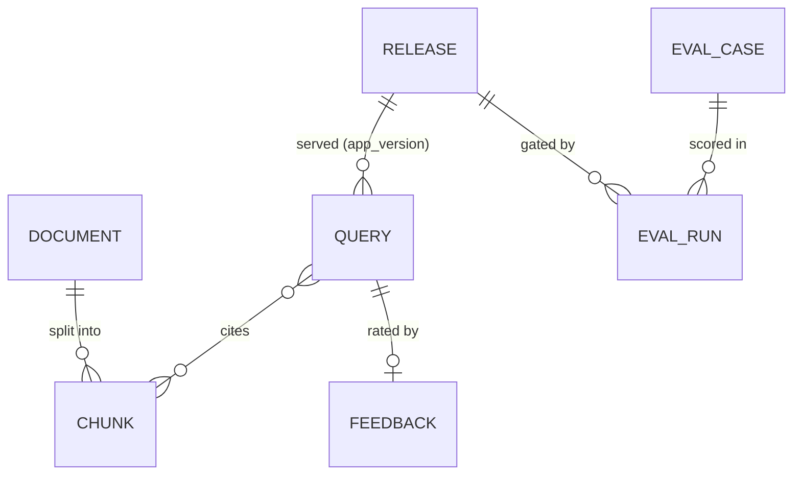

# DATA MODEL, SCAFFOLDING, FILES AND FOLDERS

> Spec: `context/SPEC.md`. Architecture: `context/ARCHITECTURE.md`. Version pins below are starting points: pin exact
> patch versions on day 1 and record them in `ansible/group_vars/all/main.yml`.

## 0. Where data lives (there is no relational database, by design: ARCH ADR-8)

| Entity | Store | Owner of writes | Key |
|---|---|---|---|
| Document (a circular) | `data/corpus/manifest.yaml` (git) + PDF in `data/corpus/raw/` | Humans (curation) | `doc_id` |
| Chunk | Qdrant collection `circulars_v1` (point = vector + payload) | `ingest` Job | `uuid5(doc_id:chunk_index)` |
| Query / Answer | Log event `request.completed` → Elasticsearch | api | `request_id` |
| Feedback | Log event `feedback.received` → Elasticsearch | api | `request_id` |
| Eval case | `eval/golden.jsonl` (git) | Humans | `id` |
| Eval run | `eval/results/<sha>.json` (Jenkins artifact) + log event `eval.result` | `run_eval.py` | `(app_version, stage)` |
| Release | ConfigMap `niyam-release` in ns `niyam` | Ansible (`deploy.yml` on success) | single object |
| Secret | Vault KV v2 `secret/niyam/*` | Ansible `vault` role | path |



## 1. Document: `data/corpus/manifest.yaml`

```yaml
version: 1
documents:
  - doc_id: rbi-2025-digital-lending-directions      # kebab-case, unique, stable forever
    file: raw/rbi-2025-digital-lending-directions.pdf # relative to data/corpus/
    title: "Reserve Bank of India (Digital Lending) Directions, 2025"
    regulator: RBI                                    # enum: RBI | SEBI
    doc_type: master_direction                        # enum: master_direction | master_circular | circular | notification
    circular_no: "RBI/2025-26/XX"                     # as printed; may be null
    issued_date: 2025-05-08                           # ISO date
    source_url: "https://www.rbi.org.in/..."          # official link shown in citations
    sha256: "<hex>"                                   # of the PDF; ingest skips unchanged docs
    tags: [digital-lending, nbfc]
```
Validation (pydantic `ManifestEntry`): `doc_id` regex `^[a-z0-9-]{5,80}$`; file exists; sha256 matches; date ≤ today. Fill in real values from the RBI/SEBI sites; the above is a format example.

## 2. Chunk: Qdrant collection `circulars_v1`

| Setting | Value |
|---|---|
| Vector | size **384**, distance **Cosine** (BAAI/bge-small-en-v1.5 via fastembed) |
| Point ID | `uuid5(NAMESPACE_URL, f"{doc_id}:{chunk_index}")`: idempotent upsert |
| Payload indexes | `regulator` (keyword), `doc_id` (keyword), `issued_year` (integer) |
| Chunking | per page, ~800 chars, 120 overlap, never across pages; drop chunks < 80 chars |

Payload:
```json
{
  "doc_id": "rbi-2025-digital-lending-directions",
  "chunk_index": 17,
  "text": "…chunk text…",
  "page_start": 6, "page_end": 6,
  "title": "Reserve Bank of India (Digital Lending) Directions, 2025",
  "regulator": "RBI", "doc_type": "master_direction", "circular_no": "RBI/2025-26/XX",
  "issued_date": "2025-05-08", "issued_year": 2025,
  "source_url": "https://www.rbi.org.in/...",
  "doc_sha256": "<hex>", "embed_model": "BAAI/bge-small-en-v1.5", "ingest_run_id": "<sha8>-<epoch>"
}
```
Collection versioning: changing the embed model or chunking → create `circulars_v2`, re-ingest, switch `NIYAM_QDRANT_COLLECTION`. Never mutate the vectors of a live collection in place.

## 3. API contract (`services/api/app/models/schemas.py`, pydantic v2)

```python
class Filters(BaseModel):
    regulator: Literal["RBI", "SEBI"] | None = None
    year_from: int | None = Field(None, ge=1990, le=2100)
    year_to:   int | None = Field(None, ge=1990, le=2100)

class AskRequest(BaseModel):
    question: str = Field(min_length=3, max_length=500)
    top_k: int = Field(6, ge=1, le=8)
    filters: Filters | None = None

class Citation(BaseModel):
    n: int                       # the [n] used in the answer
    doc_id: str; title: str; regulator: str
    circular_no: str | None; issued_date: date
    page: int; snippet: str = Field(max_length=300)
    source_url: HttpUrl; score: float

class Latency(BaseModel):
    embed: int; retrieve: int; generate: int; total: int   # ms

class AskResponse(BaseModel):
    request_id: str              # uuid4, also in X-Request-ID header
    answer: str
    citations: list[Citation]
    refused: bool
    model: str | None            # e.g. qwen2.5:3b; None when refused
    prompt_version: str          # e.g. v1
    app_version: str             # git short SHA
    latency_ms: Latency

class SearchRequest(BaseModel):  # same fields as AskRequest, but top_k defaults to 4
    ...
class SearchResponse(BaseModel):
    request_id: str; hits: list[Citation]; app_version: str; latency_ms: Latency

class FeedbackRequest(BaseModel):
    request_id: UUID4; rating: Literal["up", "down"]; comment: str | None = Field(None, max_length=500)

class ErrorResponse(BaseModel):
    request_id: str; error: Literal["validation_error", "llm_unavailable", "vector_db_unavailable", "internal"]; detail: str
```

| Method | Path | Body → Response | Codes |
|---|---|---|---|
| POST | `/api/v1/ask` | AskRequest → AskResponse | 200, 422, 503 (`llm_unavailable` / `vector_db_unavailable`) |
| POST | `/api/v1/search` | SearchRequest → SearchResponse | 200, 422, 503 |
| POST | `/api/v1/feedback` | FeedbackRequest → `{ok:true}` | 202, 422 |
| GET | `/api/v1/documents` | → `[{doc_id,title,regulator,issued_date,chunks}]` | 200 |
| GET | `/version` | → `{app_version, prompt_version, embed_model, llm_model, collection}` | 200 |
| GET | `/healthz` | liveness → `{status:"ok"}` | 200 |
| GET | `/readyz` | embedder loaded + Qdrant reachable → `{ready, checks:{embedder,qdrant,ollama(info only)}}` | 200 / 503 |

Refusal message (constant): `"I couldn't find this in the indexed RBI/SEBI circulars. Try rephrasing, or check the regulator's website."`

## 4. Log events (stdout JSON → ELK)

Every line, all services (`app/logging.py`; nginx via a JSON `log_format`):
```json
{"ts":"2026-11-21T17:40:02.123Z","level":"INFO","service":"niyam-api","app_version":"a1b2c3d",
 "pod":"niyam-api-7d9c-xk2","event":"request.completed","request_id":"…uuid…", "...event fields": "..."}
```

| `event` | Extra fields |
|---|---|
| `request.completed` | `method, path, status, latency_ms{embed,retrieve,generate,total}, question (≤200 chars), question_hash, top_k, hits, top_score, refused, model, prompt_version, completion_tokens` |
| `request.failed` | `method, path, status, error_type, error_message` |
| `llm.error` | `error_type (timeout/connect/http), elapsed_ms` |
| `ingest.doc_indexed` / `ingest.doc_skipped` | `doc_id, chunks, reason (unchanged/scanned/error), elapsed_ms` |
| `ingest.completed` | `ingest_run_id, docs_indexed, docs_skipped, chunks_total, elapsed_ms` |
| `feedback.received` | `rating, has_comment` |
| `eval.result` | `stage (ci/live), passed, metrics{hit_at_k, keyword_recall, citation_rate, refusal_accuracy, p95_search_ms, p95_ask_ms}, thresholds_version, cases` |
| `http.access` (web/nginx) | `method, path, status, bytes, latency_ms, ua` |

Health-check requests (`/healthz`, `/readyz`) are **not** logged (noise).

**In Elasticsearch** these land under `app.*` (Logstash `json { target => "app" }`), next to Filebeat's `kubernetes.*`.
Index template `infra/elasticsearch/index-template.json` (pattern `niyam-app-*`), key mappings:
```json
{
  "index_patterns": ["niyam-app-*"],
  "template": { "settings": {"number_of_shards": 1, "number_of_replicas": 0},
    "mappings": { "dynamic": true, "properties": { "app": { "properties": {
      "ts": {"type":"date"}, "level":{"type":"keyword"}, "service":{"type":"keyword"},
      "app_version":{"type":"keyword"}, "event":{"type":"keyword"}, "request_id":{"type":"keyword"},
      "path":{"type":"keyword"}, "status":{"type":"integer"}, "refused":{"type":"boolean"},
      "question":{"type":"text","fields":{"kw":{"type":"keyword","ignore_above":200}}},
      "top_score":{"type":"float"}, "model":{"type":"keyword"}, "prompt_version":{"type":"keyword"},
      "latency_ms":{"properties":{"embed":{"type":"integer"},"retrieve":{"type":"integer"},"generate":{"type":"integer"},"total":{"type":"integer"}}},
      "metrics":{"properties":{"hit_at_k":{"type":"float"},"keyword_recall":{"type":"float"},"citation_rate":{"type":"float"},"refusal_accuracy":{"type":"float"}}},
      "passed":{"type":"boolean"}, "stage":{"type":"keyword"}, "rating":{"type":"keyword"}
    }}}}
  }
}
```
replicas = 0 because it is a single-node ES (otherwise the index health stays yellow).

## 5. Eval data

`eval/golden.jsonl`, one case per line (target 25–30 cases: ~20 answerable, ~5 out-of-scope, a few with filters):
```json
{"id":"dl-001","question":"What is the minimum cooling-off period for digital loans?","expected_doc_ids":["rbi-2025-digital-lending-directions"],"must_include":["cooling","one day"],"should_refuse":false,"generate":true,"fixture":true}
{"id":"oos-001","question":"Who won the 2024 IPL final?","expected_doc_ids":[],"must_include":[],"should_refuse":true,"generate":false,"fixture":true}
```
`fixture: true` = answerable from the 3-doc CI fixture corpus (used by the CI gate). `generate: true` = included in the generation subset.

`eval/thresholds.yaml`:
```yaml
version: 1
ci:   { hit_at_k: 0.80, keyword_recall: 0.60, citation_rate: 0.90, refusal_accuracy: 0.80, p95_search_ms: 1500 }
live: { hit_at_k: 0.80, citation_rate: 0.90, refusal_accuracy: 0.80, p95_search_ms: 1000 }
```
Metric definitions: **hit@k** = fraction of answerable cases where any `expected_doc_ids` appears in the top-k; **keyword_recall** = mean fraction of `must_include` terms found (case-insensitive) in generated answers; **citation_rate** = fraction of generated, non-refused answers with ≥1 valid `[n]`; **refusal_accuracy** = fraction of cases where `refused == should_refuse`.

`eval/results/<sha>.json`: `{app_version, stage, started_at, passed, metrics{…}, thresholds{…}, failures:[{id, reason}]}`.

## 6. Release record: ConfigMap `niyam-release`

```yaml
data:
  current_tag: a1b2c3d        # set by deploy.yml at the start of a deploy
  last_good_tag: 9f8e7d6      # set by mark_good.yml after Verify passes
  deployed_at: "2026-11-21T17:40:02Z"
```
`rollback.yml` redeploys `last_good_tag` through the same `app` role. That is safer than `kubectl rollout undo`, which may revert a Deployment the failed release never touched.

## 7. Secrets and configuration

### Vault (KV v2, mount `secret/`)
| Path | Keys | Read by (policy) |
|---|---|---|
| `secret/niyam/qdrant` | `api_key` | `niyam-api` (SA `niyam-api`: api + ingest), `niyam-qdrant` (SA `qdrant`) |
| `secret/niyam/elastic` | `elastic_password`, `logstash_writer_password`, `kibana_system_password` | Pods in ns `logging` via the injector: policy `elk-elasticsearch` (SA `elasticsearch`, reads `elastic_password`), `elk-logstash` (SA `logstash`), `elk-kibana` (SA `kibana`); Ansible `elk` role via `community.hashi_vault` lookup to create users |

Policy example (`ansible/roles/vault/templates/niyam-api-policy.hcl.j2`):
```hcl
path "secret/data/niyam/qdrant" { capabilities = ["read"] }
```
Kubernetes auth roles: `niyam-api` → `bound_service_account_names=niyam-api`, `bound_service_account_namespaces=niyam`, `policies=niyam-api`, `ttl=1h`.

### ansible-vault (`ansible/group_vars/all/vault.yml`, encrypted)
`vault_dev_root_token`, `vault_seed_qdrant_api_key`, `vault_seed_elastic_*`. Decrypted in Jenkins with credential `ansible-vault-pass`.

### Jenkins credentials
`dockerhub` (username/password, a Docker Hub access token), `ansible-vault-pass` (secret text), `github-webhook-secret` (optional).

### API configuration (env prefix `NIYAM_`, `app/config.py`)
| Var | Default | Notes |
|---|---|---|
| `NIYAM_APP_VERSION` | `dev` | Baked at build (`--build-arg APP_VERSION`) |
| `NIYAM_QDRANT_URL` | `http://qdrant.niyam.svc:6333` | |
| `NIYAM_QDRANT_API_KEY_FILE` | `/vault/secrets/qdrant` | `NIYAM_QDRANT_API_KEY` is accepted for local dev only |
| `NIYAM_QDRANT_COLLECTION` | `circulars_v1` | |
| `NIYAM_OLLAMA_URL` | `http://ollama.niyam.svc:11434` | |
| `NIYAM_LLM_MODEL` | `qwen2.5:3b` | The 1.5B model produced too many wrong cited answers |
| `NIYAM_LLM_TIMEOUT_S` | `60` | |
| `NIYAM_LLM_MAX_TOKENS` | `256` | `num_predict` |
| `NIYAM_LLM_TEMPERATURE` | `0.1` | seed fixed at 42 |
| `NIYAM_EMBED_MODEL` | `BAAI/bge-small-en-v1.5` | |
| `NIYAM_EMBED_CACHE` | `/models` | Baked in the image |
| `NIYAM_PROMPT_VERSION` | `v1` | File `app/rag/prompts/v1.txt` |
| `NIYAM_REFUSAL_THRESHOLD` | `0.68` | Tuned for bge-small scores; confirm on the golden set, then freeze |
| `NIYAM_EMBED_OFFLINE` | `false` | `true` in the image, which contains the model |
| `NIYAM_EMBED_THREADS` | `1` | Matches the pod's 1 CPU limit |
| `NIYAM_CORPUS_MANIFEST` | `/data/corpus/manifest.yaml` | Ingest only |
| `NIYAM_LOG_LEVEL` | `INFO` | |

## 8. Folder and file structure

```
niyam/
├── README.md                         # what/why, prerequisites, quickstart, demo machine spec, screenshots
├── AGENTS.md                         # canonical agent + contributor rules
├── CLAUDE.md                         # imports AGENTS.md + Claude Code specifics
├── Jenkinsfile                       # declarative pipeline (§9.4)
├── Makefile                          # dev/test/eval/bootstrap/deploy/rollback/load/zdt targets (§9.8)
├── docker-compose.yml                # local dev: api, web, qdrant (+host Ollama)
├── docker-compose.ci.yml             # eval-gate env: api:<sha>, qdrant (ephemeral)
├── .dockerignore  .gitignore  .gitattributes  .trivyignore  .editorconfig
│
├── context/                          # planning documents
│   ├── spec.pdf  SPEC.md             # source of truth
│   ├── PRD.md  ARCHITECTURE.md  ARCHITECTURE_ESSENTIAL.md
│   ├── WHAT_WILL_BREAK.md  DATA_MODEL_AND_SCAFFOLDING.md  README.md
│
├── docs/                             # documents written during the build
│   ├── HANDOFF.md                    # handoff between teammates
│   ├── adr/0001-host-vs-cluster-split.md …   # one file per ARCH §12 decision you change
│   └── report/  final-report.md, architecture.png, evidence/ (screenshots per PRD row)
│
├── services/
│   ├── api/
│   │   ├── Dockerfile                # stages: deps → model → test → runtime (§9.1)
│   │   ├── requirements.txt  requirements-dev.txt  pyproject.toml (ruff + pytest config)
│   │   ├── app/
│   │   │   ├── main.py               # FastAPI app factory, middleware (request_id, access log), routers
│   │   │   ├── config.py             # pydantic-settings, *_FILE secret loading
│   │   │   ├── logging.py            # JSON formatter, log_event(event, **fields)
│   │   │   ├── deps.py               # singletons: embedder, qdrant client, ollama client
│   │   │   ├── models/schemas.py     # §3
│   │   │   ├── routes/ ask.py  search.py  feedback.py  documents.py  health.py  version.py
│   │   │   ├── rag/
│   │   │   │   ├── embedder.py       # fastembed wrapper (warm-up at startup)
│   │   │   │   ├── retriever.py      # qdrant search + filters → list[Hit]
│   │   │   │   ├── generator.py      # ollama /api/chat client (timeouts, errors → LLMUnavailable)
│   │   │   │   ├── prompt.py         # load prompts/v{N}.txt, build numbered context
│   │   │   │   ├── citations.py      # parse [n] from the answer, drop invalid ones
│   │   │   │   ├── pipeline.py       # ask(): retrieve → refuse? → generate → cite
│   │   │   │   └── prompts/ v1.txt
│   │   │   └── ingest/
│   │   │       ├── cli.py            # python -m app.ingest.cli --manifest …
│   │   │       ├── manifest.py       # ManifestEntry model + validation
│   │   │       ├── pdf_parser.py     # pypdf, per-page text, scanned-page detection
│   │   │       └── chunker.py        # page-bounded chunking
│   │   └── tests/
│   │       ├── unit/ test_chunker.py  test_citations.py  test_prompt.py  test_pipeline_refusal.py
│   │       │         test_schemas.py  test_config_secret_file.py  test_manifest.py
│   │       └── integration/ test_ingest_and_search.py   # @pytest.mark.integration (compose)
│   └── web/
│       ├── Dockerfile                # nginxinc/nginx-unprivileged, injects APP_VERSION into index.html
│       ├── nginx.conf                # JSON access log, no-cache index.html, /healthz
│       ├── nginx.dev.conf            # dev only: proxies /api → api:8000 (K8s uses Ingress instead)
│       └── public/ index.html  app.js  styles.css
│
├── data/
│   ├── corpus/ manifest.yaml  raw/*.pdf          # 30–60 text-based circulars (~20 MB)
│   └── fixtures/ manifest.yaml  raw/*.pdf        # 3 small docs for CI
│
├── eval/
│   ├── golden.jsonl  thresholds.yaml
│   ├── run_eval.py                   # --base-url --stage ci|live --subset fixture → results JSON + eval.result log
│   └── results/                      # git-ignored; archived by Jenkins
│
├── ansible/
│   ├── ansible.cfg  requirements.yml  # collections: kubernetes.core, community.docker, community.hashi_vault
│   ├── inventory/hosts.ini           # [local] localhost ansible_connection=local
│   ├── group_vars/all/ main.yml (versions, ports, sizes)  vault.yml (ansible-vault encrypted)
│   ├── scripts/vault-pass.sh         # echoes $ANSIBLE_VAULT_PASS (for Jenkins)
│   ├── playbooks/
│   │   ├── site.yml                  # full bootstrap: all roles
│   │   ├── deploy.yml                # vault (reseed) → app (image_tag) → ingest (if corpus changed)
│   │   ├── mark_good.yml             # sets last_good_tag in ConfigMap niyam-release
│   │   ├── rollback.yml              # redeploy last_good_tag via app role
│   │   ├── ingest.yml                # run ingest Job on demand
│   │   └── teardown.yml              # delete namespaces niyam + logging (keeps PVCs unless purge=true)
│   └── roles/
│       ├── common/    tasks: apt pkgs (python3-kubernetes, jq, hey), docker group for jenkins, kubeconfig for jenkins, sysctl
│       ├── minikube/  tasks: start (cpus, memory, embed-certs), addons ingress+metrics-server, Jenkins kubeconfig sync
│       ├── ollama/    tasks: systemd override OLLAMA_HOST, pull model, discover host IP; templates: ollama-svc, ollama-endpointslice
│       ├── elk/       tasks: apply ns logging, wait ES ready, set kibana_system pw, create logstash_writer role+user, index template, import dashboards
│       │              templates: es-statefulset, es-service, logstash-configmap, logstash-deployment, logstash-service,
│       │                         kibana-deployment, kibana-service, kibana-ingress, filebeat-rbac, filebeat-configmap, filebeat-daemonset
│       ├── vault/     tasks: helm repo + install (dev), kv-v2, k8s auth, policies, roles, seed secrets; templates: policies/*.hcl.j2
│       ├── qdrant/    templates: sa, statefulset (vault-injected key), service, pvc
│       ├── app/       templates: namespace, sa, configmap, api-deployment, api-service, api-hpa, web-deployment, web-service, ingress, release-configmap
│       └── ingest/    templates: ingest-job.yaml.j2; tasks: apply, wait for completion, print logs on failure
│           (each role: defaults/main.yml, tasks/main.yml, templates/, handlers/ when needed, README.md one paragraph)
│
├── infra/
│   ├── logstash/pipeline/niyam.conf  # rendered into a ConfigMap by the elk role
│   ├── elasticsearch/index-template.json
│   └── kibana/dashboards.ndjson      # exported from Kibana UI, imported by elk role
│
└── scripts/
    ├── ci_eval.sh                    # compose up CI env → ingest fixtures → run_eval → compose down
    ├── smoke.sh                      # curl /version == $1, /readyz 200, one /search
    ├── live_eval.sh                  # run_eval --stage live --subset 5 via niyam.local
    ├── zero_downtime_check.sh        # 10 rps on /version + /api/v1/search, prints failures and version mix
    ├── load_test.sh                  # hey -z 90s -c 20 POST /api/v1/search
    └── demo_change.sh                # flips a visible UI string + bumps the footer label for the live demo
```

### Kubernetes object inventory (all rendered by Ansible)
| Namespace | Kind / name | Template (role) |
|---|---|---|
| niyam | Namespace, ServiceAccount `niyam-api`, ConfigMap `niyam-config`, ConfigMap `niyam-release` | app |
| niyam | Deployment + Service `niyam-api`, HPA `niyam-api` | app |
| niyam | Deployment + Service `niyam-web`, Ingress `niyam` | app |
| niyam | ServiceAccount `qdrant`, StatefulSet + Service `qdrant`, PVC | qdrant |
| niyam | Service `ollama` + EndpointSlice `ollama-host` | ollama |
| niyam | Job `niyam-ingest-<sha8>` | ingest |
| vault | Vault + injector (Helm release `vault`) | vault |
| logging | Namespace; SAs `elasticsearch`, `logstash`, `kibana`, `filebeat`; ClusterRole/Binding (filebeat) | elk |
| logging | StatefulSet + Service `elasticsearch` (PVC 5Gi) | elk |
| logging | ConfigMap `logstash-pipeline`, Deployment + Service `logstash` | elk |
| logging | Deployment + Service `kibana`, Ingress `kibana.niyam.local` | elk |
| logging | ConfigMap + DaemonSet `filebeat` | elk |

## 9. Key file skeletons (starting points: verify against current docs while implementing)

### 9.1 `services/api/Dockerfile` (build context = repo root)
```dockerfile
FROM python:3.12-slim AS deps
ENV PYTHONDONTWRITEBYTECODE=1 PYTHONUNBUFFERED=1 PIP_NO_CACHE_DIR=1
WORKDIR /srv
COPY services/api/requirements.txt .
RUN pip install -r requirements.txt

FROM deps AS model                     # separate layer: rarely changes, so it caches and pulls fast
RUN python -c "from fastembed import TextEmbedding; TextEmbedding('BAAI/bge-small-en-v1.5', cache_dir='/models')"

FROM model AS test
COPY services/api/requirements-dev.txt .
RUN pip install -r requirements-dev.txt
COPY services/api/ .
RUN ruff check . && pytest -q -m "not integration"

FROM model AS runtime
ARG APP_VERSION=dev
ENV NIYAM_APP_VERSION=${APP_VERSION} NIYAM_EMBED_CACHE=/models
RUN useradd -u 10001 -m niyam
COPY services/api/app ./app
COPY data/corpus /data/corpus
COPY data/fixtures /data/fixtures
USER 10001
EXPOSE 8000
CMD ["uvicorn", "app.main:build_app", "--factory", "--host", "0.0.0.0", "--port", "8000", "--no-access-log", "--timeout-graceful-shutdown", "25"]
```

### 9.2 `docker-compose.yml` (dev)
```yaml
services:
  qdrant:
    image: qdrant/qdrant:v1.15.0            # pin
    environment: { QDRANT__SERVICE__API_KEY: dev-only-key }
    ports: ["6333:6333"]
    volumes: [qdrant_data:/qdrant/storage]
  api:
    build: { context: ., dockerfile: services/api/Dockerfile, target: runtime }
    environment:
      NIYAM_QDRANT_URL: http://qdrant:6333
      NIYAM_QDRANT_API_KEY: dev-only-key    # dev only; K8s uses the Vault file
      NIYAM_OLLAMA_URL: http://host.docker.internal:11434
    extra_hosts: ["host.docker.internal:host-gateway"]
    ports: ["8000:8000"]
    depends_on: [qdrant]
  web:
    build: { context: services/web }
    volumes: ["./services/web/nginx.dev.conf:/etc/nginx/conf.d/default.conf:ro"]
    ports: ["3000:8080"]                    # 8080 is Jenkins
    depends_on: [api]
volumes: { qdrant_data: {} }
```

### 9.3 `scripts/ci_eval.sh` (the innovation gate)
```bash
#!/usr/bin/env bash
set -euo pipefail
export COMPOSE_PROJECT_NAME=niyam-ci
dc() { docker compose -f docker-compose.ci.yml "$@"; }
trap 'dc down -v' EXIT
dc up -d qdrant
dc run --rm api python -m app.ingest.cli --manifest /data/fixtures/manifest.yaml
dc up -d api
for i in $(seq 1 60); do dc exec -T api python -c "import httpx;httpx.get('http://localhost:8000/readyz').raise_for_status()" && break; sleep 2; done
mkdir -p eval/results
docker run --rm --network niyam-ci_default -v "$PWD/eval:/eval" \
  "${DOCKERHUB_NS}/niyam-api:${IMAGE_TAG}" \
  python /eval/run_eval.py --base-url http://api:8000 --stage ci --subset fixture \
  --out "/eval/results/${IMAGE_TAG}.json"      # exits non-zero if any threshold fails
```
(The `eval/` mount must be writable by uid 10001: `chmod o+w eval/results` in the script, or run that container with `--user root`.)

### 9.4 `Jenkinsfile`
```groovy
pipeline {
  agent any
  triggers { githubPush() }                       // "GitHub hook trigger for GITScm polling"
  options { disableConcurrentBuilds(); timeout(time: 45, unit: 'MINUTES'); buildDiscarder(logRotator(numToKeepStr: '20')) }
  environment {
    DOCKERHUB_NS = 'CHANGE_ME'                    // your Docker Hub username/org
    INV = 'ansible/inventory/hosts.ini'
    // NOTE: do NOT declare DEPLOYED here: environment{} values can't be reassigned later (WHAT_WILL_BREAK)
  }
  stages {
    stage('Init') { steps { script {
      env.IMAGE_TAG = sh(returnStdout: true, script: 'git rev-parse --short=7 HEAD').trim()
      env.CORPUS_CHANGED = sh(returnStatus: true,
        script: 'git diff --quiet ${GIT_PREVIOUS_SUCCESSFUL_COMMIT:-HEAD~1} HEAD -- data/corpus') == 0 ? 'false' : 'true'
    } } }
    stage('Unit tests') { steps { sh 'docker build -f services/api/Dockerfile --target test -t niyam-api-test:${IMAGE_TAG} .' } }
    stage('Build images') { steps {
      sh 'docker build -f services/api/Dockerfile --target runtime --build-arg APP_VERSION=${IMAGE_TAG} -t ${DOCKERHUB_NS}/niyam-api:${IMAGE_TAG} .'
      sh 'docker build --build-arg APP_VERSION=${IMAGE_TAG} -t ${DOCKERHUB_NS}/niyam-web:${IMAGE_TAG} services/web'
    } }
    stage('Eval gate') { steps { sh 'scripts/ci_eval.sh' } }
    stage('Scan') { steps {
      sh 'trivy image --exit-code 1 --severity CRITICAL --ignore-unfixed ${DOCKERHUB_NS}/niyam-api:${IMAGE_TAG}'
      sh 'trivy image --exit-code 1 --severity CRITICAL --ignore-unfixed ${DOCKERHUB_NS}/niyam-web:${IMAGE_TAG}'
    } }
    stage('Push to Docker Hub') { steps {
      withCredentials([usernamePassword(credentialsId: 'dockerhub', usernameVariable: 'DH_USER', passwordVariable: 'DH_PASS')]) {
        sh 'echo "$DH_PASS" | docker login -u "$DH_USER" --password-stdin'
        sh 'docker push ${DOCKERHUB_NS}/niyam-api:${IMAGE_TAG} && docker push ${DOCKERHUB_NS}/niyam-web:${IMAGE_TAG}'
      }
    } }
    stage('Deploy (Ansible → K8s)') { steps {
      withCredentials([string(credentialsId: 'ansible-vault-pass', variable: 'ANSIBLE_VAULT_PASS')]) {
        script { env.DEPLOYED = 'true' }
        sh '''ansible-playbook -i $INV ansible/playbooks/deploy.yml \
              -e image_tag=$IMAGE_TAG -e dockerhub_ns=$DOCKERHUB_NS -e corpus_changed=$CORPUS_CHANGED \
              --vault-password-file ansible/scripts/vault-pass.sh'''
      }
    } }
    stage('Verify') { steps {
      sh 'scripts/smoke.sh ${IMAGE_TAG}'
      sh 'scripts/live_eval.sh'
      withCredentials([string(credentialsId: 'ansible-vault-pass', variable: 'ANSIBLE_VAULT_PASS')]) {
        sh 'ansible-playbook -i $INV ansible/playbooks/mark_good.yml -e image_tag=$IMAGE_TAG --vault-password-file ansible/scripts/vault-pass.sh'
      }
    } }
  }
  post {
    failure { script { if (env.DEPLOYED == 'true') {
      withCredentials([string(credentialsId: 'ansible-vault-pass', variable: 'ANSIBLE_VAULT_PASS')]) {
        sh 'ansible-playbook -i $INV ansible/playbooks/rollback.yml --vault-password-file ansible/scripts/vault-pass.sh'
      }
    } } }
    always {
      archiveArtifacts artifacts: 'eval/results/*.json', allowEmptyArchive: true
      sh 'docker logout || true'
    }
  }
}
```
All `sh` steps use single quotes, so the shell (not Groovy) expands variables and secrets never get interpolated into the Groovy string.

### 9.5 Playbooks
```yaml
# ansible/playbooks/site.yml
- name: Bootstrap Niyam platform on this laptop
  hosts: local
  gather_facts: true
  roles: [common, minikube, ollama, vault, elk, qdrant, app, ingest]

# ansible/playbooks/deploy.yml
- name: Release one image tag
  hosts: local
  gather_facts: false
  vars:
    image_tag: "{{ image_tag | mandatory }}"
  roles:
    - vault                                   # idempotent reseed (dev-mode Vault)
    - app
    - role: ingest
      when: (corpus_changed | default('false') | bool) or (force_ingest | default(false) | bool)

# ansible/playbooks/rollback.yml
- name: Roll back to last good tag
  hosts: local
  gather_facts: false
  pre_tasks:
    - kubernetes.core.k8s_info: { kind: ConfigMap, name: niyam-release, namespace: niyam }
      register: rel
    - ansible.builtin.set_fact:
        image_tag: "{{ rel.resources[0].data.last_good_tag }}"
      failed_when: rel.resources | length == 0
  roles: [app]
```

### 9.6 `ansible/roles/app/tasks/main.yml`
```yaml
- name: Apply app manifests
  kubernetes.core.k8s:
    state: present
    template: "{{ item }}"
  loop:
    - namespace.yaml.j2
    - serviceaccount.yaml.j2
    - configmap.yaml.j2
    - api-deployment.yaml.j2
    - api-service.yaml.j2
    - api-hpa.yaml.j2
    - web-deployment.yaml.j2
    - web-service.yaml.j2
    - ingress.yaml.j2

- name: Record current tag
  kubernetes.core.k8s:
    state: present
    definition:
      apiVersion: v1
      kind: ConfigMap
      metadata: { name: niyam-release, namespace: "{{ niyam_ns }}" }
      data: { current_tag: "{{ image_tag }}" }
    apply: true                                   # merge; keeps last_good_tag

- name: Wait for rollouts (fails the play → Jenkins post{failure} → rollback)
  ansible.builtin.command: "kubectl rollout status deployment/{{ item }} -n {{ niyam_ns }} --timeout=180s"
  loop: [niyam-api, niyam-web]
  changed_when: false
```

### 9.7 `ansible/roles/app/templates/api-deployment.yaml.j2` (key parts)
```yaml
apiVersion: apps/v1
kind: Deployment
metadata:
  name: niyam-api
  namespace: {{ niyam_ns }}
  labels: { app: niyam-api }
spec:
  # no "replicas:" here — the HPA owns it
  revisionHistoryLimit: 5
  strategy: { type: RollingUpdate, rollingUpdate: { maxSurge: 1, maxUnavailable: 0 } }
  selector: { matchLabels: { app: niyam-api } }
  template:
    metadata:
      labels: { app: niyam-api, version: "{{ image_tag }}" }
      annotations:
        vault.hashicorp.com/agent-inject: "true"
        vault.hashicorp.com/role: "niyam-api"
        vault.hashicorp.com/agent-inject-secret-qdrant: "secret/data/niyam/qdrant"
        vault.hashicorp.com/agent-inject-template-qdrant: |

          {{- with secret "secret/data/niyam/qdrant" -}}{{ .Data.data.api_key }}{{- end -}}

    spec:
      serviceAccountName: niyam-api
      terminationGracePeriodSeconds: 30
      securityContext: { runAsNonRoot: true, runAsUser: 10001 }
      containers:
        - name: api
          image: "{{ dockerhub_ns }}/niyam-api:{{ image_tag }}"
          imagePullPolicy: IfNotPresent           # safe: tags are immutable SHAs
          ports: [{ containerPort: 8000 }]
          envFrom: [{ configMapRef: { name: niyam-config } }]
          resources:
            requests: { cpu: 250m, memory: 512Mi }
            limits:   { cpu: "1",  memory: 1Gi }
          readinessProbe: { httpGet: { path: /readyz, port: 8000 }, periodSeconds: 5, failureThreshold: 3 }
          livenessProbe:  { httpGet: { path: /healthz, port: 8000 }, initialDelaySeconds: 20, periodSeconds: 10 }
          startupProbe:   { httpGet: { path: /readyz, port: 8000 }, periodSeconds: 5, failureThreshold: 30 }
          lifecycle: { preStop: { exec: { command: ["sh", "-c", "sleep 5"] } } }
```
`api-hpa.yaml.j2`:
```yaml
apiVersion: autoscaling/v2
kind: HorizontalPodAutoscaler
metadata: { name: niyam-api, namespace: {{ niyam_ns }} }
spec:
  scaleTargetRef: { apiVersion: apps/v1, kind: Deployment, name: niyam-api }
  minReplicas: {{ api_hpa_min | default(2) }}
  maxReplicas: {{ api_hpa_max | default(4) }}
  metrics: [{ type: Resource, resource: { name: cpu, target: { type: Utilization, averageUtilization: {{ api_hpa_cpu | default(60) }} } } }]
  behavior: { scaleDown: { stabilizationWindowSeconds: 60 } }
```
On the very first deploy, the Deployment starts at 1 replica until the HPA raises it to 2. That is expected.

### 9.8 `infra/logstash/pipeline/niyam.conf`
```
input  { beats { port => 5044 } }
filter {
  json { source => "message" target => "app" skip_on_invalid_json => true }
  if [app][ts] { date { match => ["[app][ts]", "ISO8601"] } }
  mutate { remove_field => ["agent", "ecs", "input", "host"] }
}
output {
  elasticsearch {
    hosts => ["http://elasticsearch.logging.svc:9200"]
    user => "logstash_writer"  password => "${LOGSTASH_WRITER_PASSWORD}"   # exported from /vault/secrets/logstash by the container wrapper
    index => "niyam-app-%{+YYYY.MM.dd}"
  }
}
```

### 9.9 `Makefile` targets
```make
dev:          ; docker compose up --build
test:         ; docker build -f services/api/Dockerfile --target test -t niyam-api-test .
test-local:   ; cd services/api && pytest -q
lint:         ; cd services/api && ruff check . && ruff format --check .
eval:         ; python eval/run_eval.py --base-url http://localhost:8000 --stage ci
bootstrap:    ; ansible-playbook -i ansible/inventory/hosts.ini ansible/playbooks/site.yml --ask-vault-pass
deploy:       ; ansible-playbook -i ansible/inventory/hosts.ini ansible/playbooks/deploy.yml -e image_tag=$(TAG) --ask-vault-pass
rollback:     ; ansible-playbook -i ansible/inventory/hosts.ini ansible/playbooks/rollback.yml --ask-vault-pass
vault-reseed: ; ansible-playbook -i ansible/inventory/hosts.ini ansible/playbooks/deploy.yml --tags vault -e image_tag=none --ask-vault-pass
load:         ; scripts/load_test.sh
zdt:          ; scripts/zero_downtime_check.sh
```

### 9.10 ELK in Kubernetes: key parts of the `elk` role templates

`es-statefulset.yaml.j2`
```yaml
apiVersion: apps/v1
kind: StatefulSet
metadata: { name: elasticsearch, namespace: logging }
spec:
  serviceName: elasticsearch
  replicas: 1
  selector: { matchLabels: { app: elasticsearch } }
  template:
    metadata:
      labels: { app: elasticsearch }
      annotations:
        vault.hashicorp.com/agent-inject: "true"
        vault.hashicorp.com/role: "elk-elasticsearch"
        vault.hashicorp.com/agent-inject-secret-elastic: "secret/data/niyam/elastic"
        vault.hashicorp.com/agent-inject-template-elastic: |

          {{- with secret "secret/data/niyam/elastic" -}}{{ .Data.data.elastic_password }}{{- end -}}

    spec:
      serviceAccountName: elasticsearch
      securityContext: { fsGroup: 1000 }
      containers:
        - name: elasticsearch
          image: "docker.elastic.co/elasticsearch/elasticsearch:{{ elastic_version }}"   # pin one 8.x patch for all 4 Elastic images
          env:
            - { name: discovery.type, value: single-node }
            - { name: ES_JAVA_OPTS, value: "-Xms{{ es_heap }} -Xmx{{ es_heap }}" }
            - { name: node.store.allow_mmap, value: "false" }                 # no vm.max_map_count needed
            - { name: xpack.security.enabled, value: "true" }
            - { name: xpack.security.http.ssl.enabled, value: "false" }
            - { name: xpack.security.transport.ssl.enabled, value: "false" }
            - { name: cluster.routing.allocation.disk.threshold_enabled, value: "false" }   # single-node laptop only
            - { name: ELASTIC_PASSWORD_FILE, value: /vault/secrets/elastic }
          ports: [{ containerPort: 9200 }]
          resources: { requests: { cpu: 250m, memory: 1536Mi }, limits: { memory: 2Gi } }
          readinessProbe:
            exec: { command: ["sh", "-c", "curl -s -u elastic:$(cat /vault/secrets/elastic) localhost:9200/_cluster/health | grep -qE '\"status\":\"(green|yellow)\"'"] }
            periodSeconds: 10
          volumeMounts: [{ name: data, mountPath: /usr/share/elasticsearch/data }]
  volumeClaimTemplates:
    - metadata: { name: data }
      spec: { accessModes: [ReadWriteOnce], resources: { requests: { storage: 5Gi } } }
```

`kibana-deployment.yaml.j2` (only the container part; Vault annotations as above with role `elk-kibana` and key `kibana_system_password`)
```yaml
      containers:
        - name: kibana
          image: "docker.elastic.co/kibana/kibana:{{ elastic_version }}"
          command: ["sh", "-c", "export ELASTICSEARCH_PASSWORD=$(cat /vault/secrets/kibana) && exec /usr/local/bin/kibana-docker"]
          env:
            - { name: ELASTICSEARCH_HOSTS, value: "http://elasticsearch.logging.svc:9200" }
            - { name: ELASTICSEARCH_USERNAME, value: kibana_system }
            - { name: NODE_OPTIONS, value: "--max-old-space-size=800" }
          resources: { requests: { cpu: 200m, memory: 768Mi }, limits: { memory: 1200Mi } }
          startupProbe: { httpGet: { path: /api/status, port: 5601 }, periodSeconds: 10, failureThreshold: 30 }
```
Logstash uses the same wrapper pattern (`export LOGSTASH_WRITER_PASSWORD=$(cat /vault/secrets/logstash) && exec /usr/local/bin/docker-entrypoint`),
with `LS_JAVA_OPTS=-Xms512m -Xmx512m` and the pipeline mounted from ConfigMap `logstash-pipeline`.
Check each image's real entrypoint path against the Elastic image docs for the version you pin.

`roles/elk/tasks/main.yml` order: apply namespace + SAs + RBAC → apply ES → wait until `elasticsearch-0` is Ready →
`k8s_exec` into it to set the `kibana_system` password and create the `logstash_writer` role and user (passwords from the
`community.hashi_vault` lookup) → `PUT _index_template/niyam-app` from `infra/elasticsearch/index-template.json` →
apply Logstash, Kibana, Ingress, Filebeat → wait for Kibana → import `infra/kibana/dashboards.ndjson` via
`http://kibana.niyam.local/api/saved_objects/_import?overwrite=true` (header `kbn-xsrf: true`).

## 10. Bootstrap order (first time on the demo laptop)

1. Install prerequisites: Docker, minikube, kubectl, helm, ansible (+ `ansible-galaxy collection install -r ansible/requirements.yml`), Jenkins (Windows service) with the Ubuntu agent from `make agent-install`, Ollama, trivy, hey, smee-client or ngrok.
2. `ansible-vault create ansible/group_vars/all/vault.yml` → fill the seeds.
3. `make bootstrap` → common → minikube (profile `niyam`, `--driver=docker --cpus=4 --memory=9g --disk-size=40g --ports=127.0.0.1:80:80`, embed-certs) → ollama → vault → elk → qdrant → app (first tag pushed manually) → ingest. Vault must be up before `elk`, because ELK pods get their passwords from the injector.
4. Jenkins: install plugins (Git, GitHub, Pipeline, Credentials Binding, Docker Pipeline optional); add the 2 credentials; create a Pipeline job "from SCM" with the GitHub hook trigger + Poll SCM `H/2 * * * *` fallback.
5. GitHub → Settings → Webhooks → `https://<smee-or-ngrok>/github-webhook/`, content type `application/json`, push events.
6. Build Kibana dashboard panels (ARCH §7) → export → commit `infra/kibana/dashboards.ndjson`.
7. Push a trivial change → watch it flow end to end. **This is PRD milestone P1.**
